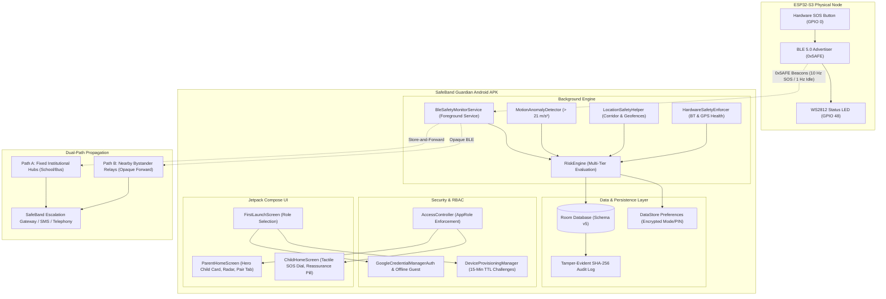

# SafeBand Guardian: Architecture Specification

## 1. System Overview

SafeBand Guardian is an offline-first, decentralized child-safety ecosystem designed to bridge physical low-power hardware wearables (ESP32-S3) with parent and community mobile devices running Android.

Unlike conventional cellular child trackers that stream continuous GPS coordinates to centralized cloud servers, SafeBand Guardian prioritizes:
- **Event-Driven Telemetry:** Transmitting location and bio-telemetry only when safety anomalies or explicit emergency triggers occur.
- **Privacy-Preserving Relaying:** Utilizing nearby smartphones and fixed infrastructure hubs to forward emergency packets without leaking child or family identities to intermediate nodes.
- **Single Unified APK with Strict Role Isolation:** Packing both the Parent and Child user experiences into a single distributable APK, strictly governed by on-device Role-Based Access Control (`AccessController`).

---

## 2. High-Level Component Architecture

---

## 3. Core Architectural Modules

### 3.1 Role Separation & Access Control (RBAC)
- **Unified Binary:** The package `com.aistudio.safeband.xqmt` contains two complete user workflows: `AppRole.PARENT` and `AppRole.CHILD`.
- **Enforcement Layer:** Authorization is validated at ViewModel entry points (`SafeBandViewModel.kt`) and repository methods using `AccessController.requireParentRole()`.
- **Lockdown Boundary:** Once configured as a child device, the application transitions into an un-dismissible child interface. Exiting child mode requires verifying the family master PIN or an active authorization challenge. Arbitrary 6-digit inputs are explicitly rejected with attempt rate-limiting.

### 3.2 Data Persistence (Room Schema Version 5)
The application utilizes an on-device SQLite database via Android Room, maintaining zero dependency on external databases for local operation:
1. `children`: Profile metadata, blood group, emergency contact numbers, assigned wearable band IDs.
2. `incidents`: Safety alerts, anomaly triggers, sensor snapshots, resolution states (`OPEN`, `RESOLVED`, `FALSE_ALARM`).
3. `safe_zones`: Geofence definitions (latitude, longitude, radius in meters, zone type: `HOME`, `SCHOOL`, `CORRIDOR`).
4. `guardian_contacts`: Priority-ordered contact directory for automated SMS and emergency telephony escalation.
5. `audit_log`: Append-only, tamper-evident blackbox log where each state change is chained using SHA-256 digests.

### 3.3 Multi-Tier Risk Evaluation Engine (`RiskEngine`)
Sensor inputs are continuously ingested and evaluated without user disruption:
- **NORMAL (Tier 0):** Zero anomalies detected. Background BLE scanner operates in low-power scan duty cycle (10%).
- **LOW (Tier 1):** Single isolated anomaly (e.g., motion spike without zone exit, or minor GPS inaccuracy). Recorded to local audit log; no siren or transmission initiated.
- **MEDIUM (Tier 2):** Two concurrent anomalies (e.g., geofence perimeter departure combined with accelerometer fall signature). Initiates an audible 10-second user cancellation countdown.
- **HIGH / CRITICAL (Tier 3):** Confirmed emergency: Physical ESP32 SOS button held for 2 seconds, in-app tactile SOS dial triggered, or countdown expiration. Initiates instant 10 Hz BLE emergency broadcasts, maximum volume audio siren (`USAGE_ALARM`), screen wake lock, and full-screen notification override.

### 3.4 BLE Hardware Protocol Contract (`0x5AFE`)
The mobile application interfaces directly with the ESP32-S3 wearable node using standard BLE advertising:
- **Manufacturer Company ID:** `0x5AFE` (encoded in little-endian format as `0xFE, 0x5A`).
- **Packet Structure:**
  - `Byte 0-1`: Magic Bytes `0x53, 0x42` (`'S'`, `'B'`).
  - `Byte 2-8`: 7-byte ASCII Device Identifier (e.g., `EP-C0D7`).
  - `Byte 9`: Risk / Packet Type Byte (`0x00`=Normal, `0x01`=Low, `0x02`=Medium, `0x03`=High/SOS; or packet identifiers `0x02`=BioCore, `0x03`=ContactPhone).
  - `Byte 10-13`: Big-endian Unix Epoch Timestamp.
  - `Byte 14-17`: IEEE 754 Float32 Latitude.
  - `Byte 18-21`: IEEE 754 Float32 Longitude.
  - `Byte 22-23`: Battery level and sensor status flags.

### 3.5 Privacy-Preserving Relay Propagation
When an emergency occurs outside direct parent BLE range:
- **Path A (Fixed Infrastructure Hubs):** School entrance beacons and bus relay hubs ingest the `0x5AFE` broadcast and upload authenticated incidents directly to the backend gateway.
- **Path B (Nearby Smartphone Relay):** Any mobile phone running SafeBand Guardian receives the emergency beacon and acts as a dumb store-and-forward relay. Relaying devices forward the encrypted payload to emergency dispatch without decrypting child identity, age, or medical details.
