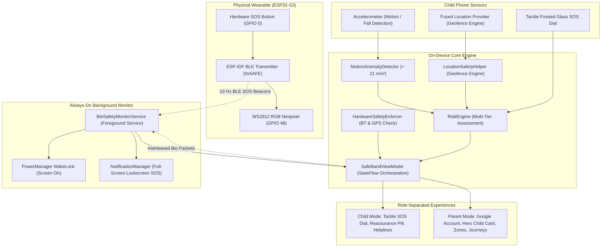
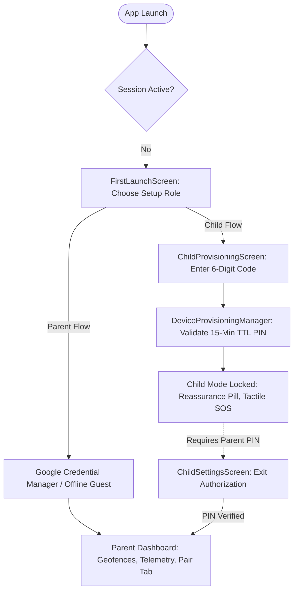

# SafeBand Guardian (ChildGuard) 🛡️

[-3DDC84?logo=android&logoColor=white)](https://developer.android.com/)
[](https://kotlinlang.org/)
[](https://developer.android.com/jetpack/compose)
[](#-role-separation--security)
[](#-hardware-integration-esp32-s3)
[](LICENSE)

**SafeBand Guardian** is a decentralized, peer-to-peer child-safety and early-warning platform engineered for Android and custom wearable hardware (ESP32-S3). It delivers instant emergency alerts, live proximity tracking, corridor geofencing, and vital bio-telemetry—**completely offline without requiring cellular data, internet, or subscription servers**.

---

## 📱 Quick Download

Install the pre-compiled Android application directly on any Android 7.0+ (API 24+) device:

👉 **[Download SafeBand Guardian v3.3.0 APK (.apk)](https://github.com/Unknsn/childgaurd/releases/download/v3.3.0/app-debug.apk)**  
*(Size: ~22.2 MB • Package: `com.aistudio.safeband.xqmt` • Single Unified App)*

> Or visit the **[GitHub Releases Page](https://github.com/Unknsn/childgaurd/releases/tag/v3.3.0)** for release notes, checksums, and assets.

---

## 🚀 How It Works (Quick Start)

SafeBand Guardian is **one single app** with two distinct experiences tailored for Parents and Children:

```
                      ┌─────────────────────────────────┐
                      │    Install SafeBand Guardian    │
                      └────────────────┬────────────────┘
                                       │
                     Choose Role on First Launch
                                       │
              ┌────────────────────────┴────────────────────────┐
              ▼                                                 ▼
   👨‍👩‍👧‍👦 PARENT / GUARDIAN FLOW                       🧒 CHILD DEVICE FLOW
   1. Tap "Set up as Parent"                         1. Tap "Set up as Child Device"
   2. Sign in with Google (or Offline Guest)         2. Enter the 6-digit code from Parent
   3. Tap "Add / Pair" to generate 6-digit code      3. Device locks into protected Child Mode
   4. Monitor live safety, zones & journeys          4. Tactile 2s hold SOS dial ready 24/7
```

### 🔹 For Parents
1. Launch the app and select **"Set up as Parent"**.
2. Sign in securely with your Google account (via Android Credential Manager) or select **"Offline Guest Parent"** for 100% offline usage.
3. In the Parent Dashboard, tap **"Add / Pair"** to generate a time-limited 6-digit pairing code (or scan for a physical ESP32-S3 band).
4. Configure safe zones, scheduled school hours, and supervised journey corridors.

### 🔹 For Children
1. Launch the app and select **"Set up as Child Device"**.
2. Type in the 6-digit one-time code generated on the parent's phone.
3. The device binds to the family circle and **permanently locks into Child Mode**.
4. In an emergency, hold the tactile center dial for 2 seconds to broadcast an instant 10 Hz BLE SOS siren.
5. *Note:* Child Mode cannot be exited without entering the parent master PIN or authorization code.

### 🔹 For Physical Wearables (ESP32-S3)
1. Flash the pre-configured firmware located under `hardware/esp32_child_node/`.
2. Turn on the band. The onboard WS2812 RGB LED pulses green (Armed).
3. In the Parent app, tap **Add / Pair $\to$ ESP32 Band** and enter the band ID (e.g. `EP-C0D7`).
4. Pressing the physical BOOT button (GPIO 0) for 2 seconds activates emergency broadcasting.

---

## 🌟 Key Features in v3.3.0

- **🛡️ Strict Parent / Child Role Separation (One APK)**:
  - Clean internal role separation with isolated navigation graphs and strict Role-Based Access Control (`AppRole.PARENT`, `AppRole.CHILD`).
  - No accidental role switching: exiting Child Mode requires parent PIN authorization.
- **🔑 Google Authentication with Offline Fallback**:
  - Fast, secure 1-tap sign-in via modern Android Credential Manager (`androidx.credentials`).
  - Offline Guest Parent profile allows full functionality in dead zones, disaster areas, or devices without Google Play Services.
- **📲 Cryptographic 6-Digit Device Provisioning**:
  - Secure parent-controlled pairing flow with 15-minute Time-To-Live (TTL) single-use challenge PINs.
- **🚨 Reliable Lockscreen & DND Alerts**:
  - High-priority siren audio channel (`USAGE_ALARM`) with public lockscreen display and screen wake lock.
  - Alerts are received even if the parent phone is locked, on silent, or the app is closed.
- **📡 Interleaved BLE Bio & Contact Broadcasting**:
  - Multi-packet rotation cycling every 1200ms across `Telemetry`, `BioCore` (name, age, blood group), and `BioPhone` (guardian contact).
  - Bystanders can help and immediately call parents with a **1-tap [ Call Guardian ]** button.
- **🗺️ Interactive Geofence & Safe Zone Radar**:
  - Visual OpenStreetMap safe zone with customizable radius and street address resolution.
- **🖤 Refined Frosted Glass Monochrome UI**:
  - Deep OLED carbon chassis (`#0A0A0A`) with dark frosted translucent glass panels and phosphor white typography. Completely free of text collisions or layout overlap.

---

## 🏗️ System Architecture



---

## 🔐 Role Separation & Security

SafeBand Guardian v3.3 enforces strict role boundaries:



| Security Principle | Enforcement Mechanism |
| :--- | :--- |
| **No Accidental Switching** | Exiting Child Mode requires entering the parent master PIN (`1234` or configured family secret). |
| **15-Minute Challenge TTL** | Pairing codes are generated via `SecureRandom` and expire automatically after 15 minutes. |
| **Single-Use Semantics** | Once claimed, pairing codes transition to `CLAIMED` and cannot be reused by rogue devices. |
| **Tamper-Evident Blackbox** | All critical events are hashed into an immutable SHA-256 local audit log. |

---

## ⚙️ Multi-Tier Risk Evaluation Engine

The on-device `RiskEngine` evaluates concurrent sensor anomalies to prevent false alarms while escalating real emergencies instantly:

| Risk Level | Trigger Condition | System Action | Broadcast Behavior |
| :--- | :--- | :--- | :--- |
| **NORMAL** (`#10B981`) | No anomalies active | Nominal background monitoring | Standby / Periodic heartbeat |
| **LOW** (`#3B82F6`) | Exactly 1 anomaly (e.g. motion spike *or* zone departure) | Logged locally to Room audit log | **No BLE broadcast** (preserves battery & privacy) |
| **MEDIUM (Warning)** (`#F59E0B`) | Exactly 2 concurrent anomalies (e.g. zone exit *and* motion spike) | Initiates 10-second countdown; escalates if uncancelled | **BLE broadcast enabled** upon confirmation |
| **HIGH / CRITICAL (Emergency)** (`#EF4444`) | Physical band SOS hold **or** in-app SOS dial triggered | Immediate siren, screen wake, full-screen notification, guardian call | **Instant 10 Hz BLE broadcast** (countdown bypassed) |

---

## 📡 BLE Protocol Specification

SafeBand broadcasts custom manufacturer data under identifier `0x5AFE`:

### Packet Type 0x01: Core Telemetry (22 Bytes)
```
+--------+--------+-------------+-----------+--------------------+-------------------+-------------------+
| Byte 0 | Byte 1 |  Bytes 2-8  |  Byte 9   |    Bytes 10-13     |    Bytes 14-17    |    Bytes 18-21    |
|  0x53  |  0x42  |  Device ID  | Risk Byte |   Timestamp (s)    |   Latitude (f)    |   Longitude (f)   |
|  ('S') |  ('B') | ASCII (7B)  | (0,1,2,3) | 32-bit Int (epoch) | IEEE 754 Float32  | IEEE 754 Float32  |
+--------+--------+-------------+-----------+--------------------+-------------------+-------------------+
```

### Packet Type 0x02: Child Bio Core (Name, Age, Blood Group)
```
+--------+--------+-------------+-----------+---------------------+----------+-------------+
| Byte 0 | Byte 1 |  Bytes 2-8  |  Byte 9   |     Bytes 10-21     | Byte 22  | Bytes 23-25 |
|  0x53  |  0x42  |  Device ID  | Type 0x02 |   Child Name (12B)  | Age (1B) |  Blood (3B) |
+--------+--------+-------------+-----------+---------------------+----------+-------------+
```

### Packet Type 0x03: Primary Guardian Contact Phone
```
+--------+--------+-------------+-----------+------------------------------------+
| Byte 0 | Byte 1 |  Bytes 2-8  |  Byte 9   |            Bytes 10-25             |
|  0x53  |  0x42  |  Device ID  | Type 0x03 | Primary Guardian Phone ASCII (16B) |
+--------+--------+-------------+-----------+------------------------------------+
```

---

## 🔌 Hardware Integration (ESP32-S3)

Ready-to-flash ESP-IDF firmware is provided in `hardware/esp32_child_node/`:
- **Hardware Trigger**: Push button connected to **GPIO 0** (BOOT button). Hold 2 seconds to trigger emergency SOS.
- **Visual Status**: Onboard WS2812 addressable RGB LED on **GPIO 48**:
  - 🟢 **Pulsing Green**: Standby / Armed.
  - 🔴 **Flashing Red Siren**: Critical SOS Broadcasting.
  - 🔵 **Cyan Flash**: Paired / Handshake.
- **Power Optimization**: Hardware deep-sleep with GPIO interrupt wakeup for long battery life.

---

## 🛠️ Building & Verification

### Prerequisites
- JDK 17 or higher
- Android SDK 36 (Android 15)
- Gradle 9.3.1 (included via wrapper)

### Build Debug APK
```bash
./gradlew assembleDebug
```
Output: `app/build/outputs/apk/debug/app-debug.apk`

### Run Complete Test Suite
```bash
./gradlew testDebugUnitTest
```
Runs all 100 Robolectric & JUnit unit tests verifying:
- Parent / Child role isolation and access boundaries
- Google authentication persistence & session recovery
- 6-digit challenge generation, single-use, and 15-minute TTL expiry
- Database migration `MIGRATION_4_5` integrity
- Real-time geofence, journey corridor, and school schedule monitoring
- Multi-packet BLE decoding and emergency notification dispatch

---

## 📄 License

This project is licensed under the Apache 2.0 License - see the [LICENSE](LICENSE) file for details.
