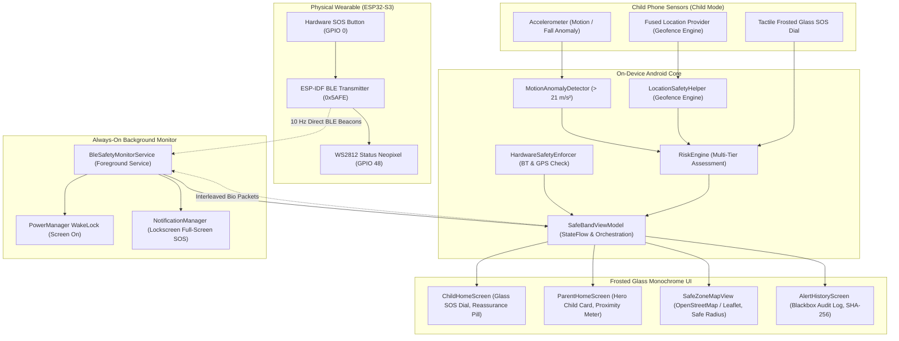

# SafeBand Guardian (ChildGuard) 🛡️

[](https://developer.android.com/)
[](https://kotlinlang.org/)
[](https://developer.android.com/jetpack/compose)
[](#hardware-integration)
[](#system-architecture)
[](LICENSE)

**SafeBand Guardian** is a peer-to-peer child-safety early-warning system built natively for Android and custom wearable hardware (ESP32-S3). It combines **Bluetooth Low Energy (BLE) direct peer beaconing**, **real-time motion anomaly detection**, **customizable geofencing**, **interleaved bio-telemetry broadcasting**, and an **always-on background safety monitor** to deliver immediate emergency alerts between child and parent devices—**completely offline without requiring cellular internet or centralized cloud servers**.

---

## 📱 Download & Install APK

Directly install the latest pre-compiled Android APK on any Android 7.0+ (API 24+) smartphone:

👉 **[Download SafeBand Guardian v3.2.0 Release APK (.apk)](https://github.com/Unknsn/childgaurd/releases/download/v3.2.0/app-debug.apk)**

> Or visit the **[v3.2.0 GitHub Release Page](https://github.com/Unknsn/childgaurd/releases/tag/v3.2.0)** to view release notes, checksums, and assets.

---

## 📌 What's New in v3.2.0

- **✨ Frosted Glass Monochrome UI Styling**:
  - Deep OLED carbon chassis (`#0A0A0A`) with dark frosted translucent panels (`Color(0x18FFFFFF)`), etched razor-sharp glass borders (`Color(0x26FFFFFF)`), and phosphor white typography.
  - Reusable `GlassCard`, `GlassButton`, and `HardwarePrerequisiteBanner` components with haptic feedback.
- **🧹 Complete Screen De-cluttering & Non-Overlapping Layouts**:
  - Eliminated text collisions across all screen densities.
  - Fixed perimeter displacement wrapping (`14.2m / 100m`) and safe zone coordinates (`Lat • Lon` vs `Radius`).
  - Removed engineering mock jargon (`MOD_09`, `IMU 9.81 m/s²`, `36.4°C`), duplicate battery indicators, and broken void cards.
- **🚨 Reliable Background & Lockscreen Emergency Alerts**:
  - Android `ForegroundService` with `connectedDevice|location` and `START_STICKY` ensures alerts arrive even when the app is closed or killed.
  - `WakeLock` wakes the screen and CPU immediately upon receiving an emergency packet.
  - `USE_FULL_SCREEN_INTENT`, public lockscreen notifications, and high-priority siren alarm audio attributes (`USAGE_ALARM`).
- **📡 Interleaved BLE Bio & Contact Broadcasting**:
  - Multi-packet rotation cycling every 1200ms across `Telemetry`, `BioCore` (name, age, blood type), and `BioPhone` (guardian contact).
  - Passive background scanners reassemble the child's identity and primary guardian phone number. Surrounding bystanders receive emergency alerts with a **1-tap [ Call Guardian ]** action button.
- **⚡ Bluetooth & Location Hardware Enforcer**:
  - Actively checks if Bluetooth hardware or Location services (GPS) are turned off in Android system settings.
  - Features sticky Frosted Glass warning banners and 1-tap activation triggers (`BluetoothAdapter.ACTION_REQUEST_ENABLE`, `Settings.ACTION_LOCATION_SOURCE_SETTINGS`).

---

## 🏗️ System Architecture



---

## ⚙️ Multi-Tier Risk Evaluation Engine

The `RiskEngine` evaluates concurrent sensor flags to prevent panic while ensuring critical alerts are broadcasted immediately:

| Risk Level | Trigger Condition | System Action | Broadcast Behavior |
| :--- | :--- | :--- | :--- |
| **NORMAL** (`#10B981`) | No anomalies active | Nominal monitoring | Standby / Periodic heartbeat |
| **LOW** (`#3B82F6`) | Exactly 1 anomaly (e.g. motion spike *or* safe zone departure) | Logged locally to Room audit log | **No BLE broadcast** (preserves battery & privacy) |
| **MEDIUM (Warning)** (`#F59E0B`) | Exactly 2 concurrent anomalies (e.g. safe zone exit *and* motion spike) | Initiates 10-second confirmation countdown; escalates if uncancelled | **BLE broadcast enabled** upon confirmation |
| **HIGH / CRITICAL (Emergency)** (`#EF4444`) | Physical band SOS hold **or** in-app SOS dial triggered | Immediate siren, screen wake, full-screen notification, guardian call | **Instant 10 Hz BLE broadcast** (countdown bypassed) |

---

## 📡 BLE Protocol Specification

SafeBand broadcasts custom manufacturer data under identifier `0x5AFE`:

### Packet Type 0x01: Core Telemetry (22 Bytes)
```
+--------+--------+-------------+-----------+--------------------+-------------------+-------------------+
| Byte 0 | Byte 1 |  Bytes 2-8  |  Byte 9   |    Bytes 10-13     |    Bytes 14-17    |    Bytes 18-21    |
|  0x53  |  0x42  |  Device ID  | Risk Byte |   Timestamp (s)    |   Latitude (f)    |   Longitude (f)   |
|  ('S') |  ('B') | ASCII (7B)  | (0,1,2,3) | 32-bit Int (epoch) | IEEE 754 Float32  | IEEE 754 Float32  |
+--------+--------+-------------+-----------+--------------------+-------------------+-------------------+
```

### Packet Type 0x02: Child Bio Core (Name, Age, Blood Group)
```
+--------+--------+-------------+-----------+---------------------+----------+-------------+
| Byte 0 | Byte 1 |  Bytes 2-8  |  Byte 9   |     Bytes 10-21     | Byte 22  | Bytes 23-25 |
|  0x53  |  0x42  |  Device ID  | Type 0x02 |   Child Name (12B)  | Age (1B) |  Blood (3B) |
+--------+--------+-------------+-----------+---------------------+----------+-------------+
```

### Packet Type 0x03: Primary Guardian Contact Phone
```
+--------+--------+-------------+-----------+------------------------------------+
| Byte 0 | Byte 1 |  Bytes 2-8  |  Byte 9   |            Bytes 10-25             |
|  0x53  |  0x42  |  Device ID  | Type 0x03 | Primary Guardian Phone ASCII (16B) |
+--------+--------+-------------+-----------+------------------------------------+
```

---

## 🔌 Hardware Integration (ESP32-S3 Physical Node)

The repository includes ready-to-flash firmware for the physical ESP32-S3 wearable child node under `hardware/esp32_child_node/`:
- **Hardware Trigger**: Push button connected to GPIO 0 (BOOT button). Hold 2 seconds to initiate SOS.
- **Visual Feedback**: Onboard WS2812 RGB addressable LED on GPIO 48:
  - Green pulse: Standby / Armed.
  - Blinking red siren: Critical SOS Broadcasting.
  - Cyan flash: Handshake / Paired.
- **Battery Optimization**: Deep sleep mode with GPIO wake-up interrupts for extended battery life.

---

## 🛠️ Building & Testing

### Prerequisites
- JDK 17 or higher
- Android SDK 36 (Android 15)
- Gradle 9.3.1 (included via wrapper)

### Build Debug APK
```bash
./gradlew assembleDebug
```
The resulting APK will be generated at `app/build/outputs/apk/debug/app-debug.apk`.

### Run Test Suite
```bash
./gradlew testDebugUnitTest
```
Executes all Robolectric unit tests, verifying:
- Risk engine state machine
- Hardware prerequisite enforcer (Bluetooth & GPS)
- Background emergency alert generation & wake lock
- Layout collision-free constraints
- Offline multi-packet BLE decoding and reassembly.

---

## 📄 License
This project is licensed under the Apache 2.0 License - see the [LICENSE](LICENSE) file for details.
